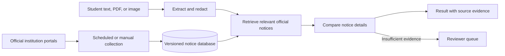

# FinalSay

**Check a forwarded campus notice against the official record.** FinalSay is a
cross-institution notice verification prototype: it collects notices from
institutional portals, extracts text from student submissions, retrieves likely
official matches, and explains whether the notices agree or describe an update.

The comparison labels describe the relationship between two notices—
`consistent`, `contradictory`, `superseded`, `corrected`, `extended`,
`cancelled`, or `unresolved`. They are not a general “real or fake” verdict.
When the official document is unavailable or evidence is weak, FinalSay keeps
the result unresolved and can send it for human review.



## Try the local demo

### Requirements

- Python 3.11
- Node.js 18 or later and npm
- Internet access for live university sources; the semantic models must already
  be cached, or downloaded once on first use

From the project root, start the app with:

```bash
make demo
```

Open **<http://127.0.0.1:5173/FinalSay-prototype/>**. The API is available at
<http://127.0.0.1:8000>, with interactive docs at <http://127.0.0.1:8000/docs>.
Press `Ctrl-C` in the terminal to stop the frontend and backend.

The launcher creates or reuses the Python virtual environment, installs the
backend and frontend dependencies, configures the selected live sources, then
starts both services. It does not seed synthetic notices into the product
database. To let a fresh checkout download uncached model weights, start with:

```bash
HF_HUB_OFFLINE=0 TRANSFORMERS_OFFLINE=0 make demo
```

The first model download is about 650 MB combined. When weights are cached, the
launcher defaults to offline model loading; source polling still uses HTTPS.
If port 8000 is already occupied, choose another API port:

```bash
FINALSAY_API_PORT=8001 make demo
```

## Who uses FinalSay

| Role | Main workflow |
|---|---|
| Student | Register, choose a college, browse its notices, and submit text or a document for comparison. |
| Admin | Configure and poll official sources, inspect scrape errors, review collected notices, manage issuer access, and view provenance. |
| Issuer | Publish an official notice for an institution to which an admin granted access. |
| Reviewer | Resolve ambiguous submissions and independently annotate shared benchmark pairs. |

FinalSay keeps scraped notice versions and their source details. Scheduled
polling defaults to every hour; admins can change the interval in **Admin →
Sources**. Manual polling is available there too. Admin review controls can
flag, archive, reject, or restore collected records. Official manual publishing
uses the separate, institution-scoped issuer workflow; the admin review screen
is not a general content editor.

## Current scope and limitations

- Live adapters are provided for VTU, University of Delhi Examination,
  University of Mumbai, and Thapar. A fresh `make demo` source-onboarding run
  configures VTU, Delhi, and Mumbai; add other supported sources from the Admin
  screen when needed.
- The comparison model runs locally. Its scores are rankings, not calibrated
  probabilities. An unresolved result means FinalSay could not verify the
  relationship from the available evidence; it does not mean the submission is
  fake.
- Some Delhi listings link to Google Drive documents. Without a read-only Drive
  service account, FinalSay can retain and retrieve the portal listing but
  cannot compare details from an inaccessible PDF. See
  [source onboarding](docs/SOURCE-ONBOARDING.md).
- Image and scanned-PDF OCR requires Tesseract. Text-layer PDFs and pasted text
  do not require it. See [OCR setup](#ocr--tesseract-note).
- The default provenance anchor is a local hash chain. Polygon Amoy is optional;
  no public-chain deployment is implied by running the local demo.

For test evidence and environment-specific limitations, see the
[functional verification report](FINAL_TEST_REPORT.md),
[Phase 2 scraping report](docs/PHASE2-SCRAPING-REPORT.md), and
[end-to-end implementation report](docs/END-TO-END-IMPLEMENTATION-REPORT.md).

## Architecture

- **Backend** — synchronous FastAPI app (`backend/finalsay`) over SQLAlchemy
  (SQLite by default, PostgreSQL opt-in). Six modules mirror the design:
  1. **Ingestion** — VTU, University of Delhi Examination, University of Mumbai, and Thapar source adapters plus student submissions. Live sources are host allow-listed, HTTPS-only, rate-limited, robots-aware, and capped by response size.
  2. **Extraction** — PDF/image/text acquisition, regex field extraction
     (issuer, date, deadline, audience, action) and PII redaction. Only
     redacted text and extracted fields are ever stored.
  3. **Provenance** — canonical SHA-256, daily Merkle tree, and a pluggable
     anchor (`LocalHashChainAnchor` default, receipt-confirmed Polygon Amoy
     anchor opt-in). Public verification reads the contract; local integrity is
     labeled separately from public-chain verification.
  4. **Comparison** — candidate retrieval + a pluggable `ComparisonModel`
     (`SemanticComparisonModel` default, with mock and legacy HF options) and
     confidence gating.
  5. **Reviewer console** — unresolved-case queue, resolve/correct, plus a
     two-annotator benchmark with Cohen's kappa.
  6. **Evaluation harness** — per-field extraction F1, relationship
     precision/recall/F1, false-confirmation and unresolved rates, kappa, and
     four baselines across `temporal` / `institution` holdout splits.
- **Frontend** — React + Vite PWA (`apps/web`) with connected student,
  reviewer, admin source-management, and issuer-publishing routes. Installable
  (manifest + service worker). In dev, Vite proxies `/api` to the backend on
  `127.0.0.1:8000`.

Temporal relations are stored as **relational edge rows** (`relation_edge`), not
a graph database. The swappable parts (comparison model, anchor, institution
adapters) sit behind ABCs. Semantic model weights require a one-time download;
inference runs locally and uses no paid keys.

See [`design.md`](design.md) for the full architecture and [`requirements.md`](requirements.md)
for the EARS requirements.
For secure Amoy deployment, wallet setup, and backend configuration, see
[`docs/POLYGON-AMOY-DEPLOYMENT.md`](docs/POLYGON-AMOY-DEPLOYMENT.md).

## Accounts and workflows

### Accounts

Students register from the app. Do not use shared or seeded credentials.
Bootstrap the first local administrator from another terminal:

```bash
cd backend
.venv/bin/python -m finalsay.services.provision_admin ADMIN_EMAIL
```

The command prompts for a password. Privileged accounts are provisioned
separately; no demo credentials are preloaded.

### Registering an official notice

An institution-scoped issuer can publish through **Issuer → Publish** or
`POST /api/issuer/publish`. The issuer must first be provisioned and granted
access to that institution. There are no preloaded demo issuer credentials.

### Starting a real blind reviewer benchmark

The product database does not ship with synthetic benchmark pairs. After a
student submits a real notice, the response includes `submission_id` and
`candidate_id`. An Admin can curate that evaluated pair into the blinded
reviewer corpus:

```bash
curl -X POST http://127.0.0.1:8000/api/admin/benchmark/pairs \
  -H "Authorization: Bearer $ADMIN_TOKEN" \
  -H 'Content-Type: application/json' \
  -d '{"submission_id": 123, "official_id": 517}'
```

The endpoint accepts only a real student submission and its persisted current
official candidate from an active live source. It snapshots the notice text,
does not copy the model's predicted label, rejects seeded demo records, and is
idempotent. Create two independent reviewer accounts from `backend/` with
`.venv/bin/python -m finalsay.seed.create_reviewer REVIEWER_EMAIL`; each
command prompts for a unique password of at least 16 characters. Both reviewers receive the same corpus,
see only their own saved labels, and must complete their passes before Cohen's
kappa is shown. Do not use synthetic seed data as human agreement evidence.

### Live institutional sources

Admins can add or update sources, pause polling or deactivate a source, poll
manually, and browse that source's collected notices from **Admin → Sources**.
The page shows the last successful poll and its new/revised/unchanged counts;
recent errors remain visible in the scrape history. Active, enabled sources are
also polled on startup and every `FINALSAY_SCRAPE_INTERVAL_SECONDS` (default
one hour). Admins can change the interval from **Admin → Sources**; the saved
setting is read by the running scheduler and survives restarts. Manual and
scheduled polls share a lock, and transient HTTP errors
receive bounded retries. Repeated unchanged documents are deduplicated;
modified documents are stored as linked versions. Active adapters are
allow-listed for VTU, University of Delhi Examination, University of Mumbai,
and Thapar. Backfill progress is recorded per source. Delhi's official listing
links to Google Drive-hosted files; the app indexes official catalog metadata
and does not fetch files disallowed by that host's robots policy.

See the [Phase 2 scraping report](docs/PHASE2-SCRAPING-REPORT.md) for current
database counts, latest poll outcomes, ML retrieval evidence, tests, and source
limitations.

For the current source, database, model, test, and deployment status, see the
[end-to-end implementation report](docs/END-TO-END-IMPLEMENTATION-REPORT.md).

### Clean-clone steps (manual, without `make`)

```bash
# 1. Backend venv + deps (Python 3.11)
python3.11 -m venv backend/.venv
backend/.venv/bin/pip install -r backend/requirements.txt
backend/.venv/bin/pip install -r backend/requirements-ml.txt

# 2. Configure the selected official sources (idempotent)
cd backend && ../backend/.venv/bin/python -m finalsay.services.source_onboarding --apply && cd ..

# 3. Backend (terminal 1; offline flags require models already cached)
cd backend && HF_HUB_OFFLINE=1 TRANSFORMERS_OFFLINE=1 .venv/bin/python -m uvicorn finalsay.main:app --host 127.0.0.1 --port 8000

# 4. Frontend (terminal 2)
cd apps/web && npm install && npm run dev
```

If this is the first run on a machine without cached model weights, set
`HF_HUB_OFFLINE=0 TRANSFORMERS_OFFLINE=0` before starting the backend once so
the models can download. If another local service already owns port 8000, run
the backend and frontend with the same alternate API port. The launcher
configures Vite's same-origin `/api` proxy from that value, so no API URL needs
to be embedded in the bundle:

```bash
FINALSAY_API_PORT=8001 FINALSAY_WEB_PORT=5173 scripts/run_demo.sh
```

The local launcher and `make backend` use cached Hugging Face model files
offline by default while keeping university-source HTTPS polling enabled. For a
fresh environment that must download model weights, start with
`HF_HUB_OFFLINE=0 TRANSFORMERS_OFFLINE=0`.

## Make targets

| Target          | Description                                             |
|-----------------|---------------------------------------------------------|
| `make demo`     | Start the local app with selected official sources.     |
| `make backend`  | Run the FastAPI backend only (uvicorn on `:8000`).      |
| `make frontend` | Run the Vite dev server only (`:5173`).                 |
| `make seed`     | Create isolated synthetic test data (`synthetic-test.db`). |
| `make test`     | Run the backend pytest suite.                           |
| `make eval`     | Run the evaluation harness for both splits.             |
| `make install`  | Create the venv and install backend requirements.       |
| `make clean`    | Remove venv, SQLite db, caches, and `node_modules`.     |

Frontend production build (PWA smoke): `cd apps/web && npm run build`.

## PostgreSQL (optional)

The demo defaults to SQLite for reliability. To run against PostgreSQL instead:

```bash
scripts/run_demo.sh --postgres
```

This boots the local PostgreSQL instance in-session, initializes the data
directory if needed, creates a local demo role/database, and points the backend
at it. The launcher-generated credentials are for loopback development only;
do not reuse them outside the local demo. To use another database, set
`FINALSAY_DATABASE_URL` to that database's SQLAlchemy URL in your shell or an
ignored local `.env` file. Never commit database credentials.

## AWS Deployment

An ECS/Fargate deployment template and GitHub OIDC workflow are provided, but
FinalSay is **not deployed**. Production requires managed PostgreSQL, AWS
Secrets Manager values, a GitHub OIDC role, an HTTPS load balancer, and a
frontend origin. SQLite and wildcard CORS are not production configuration.
See [`docs/AWS-DEPLOYMENT-GUIDE.md`](docs/AWS-DEPLOYMENT-GUIDE.md) for exact
prerequisites. The EC2 helper is loopback-only and requires externally
configured PostgreSQL and secrets; it is not a turnkey public deployment.

## Configuration (environment switches)

Most application settings use the `FINALSAY_` prefix (pydantic-settings; a
`.env` file in the working directory is honored). Polygon credentials use the
`POLYGON_AMOY_` names shown below. See [`.env.example`](.env.example).

| Variable | Default | Effect |
|---|---|---|
| `FINALSAY_DATABASE_URL` | `sqlite:///./finalsay.db` | SQLAlchemy URL. Set to your PostgreSQL URL to use Postgres. |
| `FINALSAY_COMPARISON_MODEL` | `semantic` | `semantic` (local embedding retrieval + NLI), `mock` (rule engine), or `hf` (legacy BART zero-shot). |
| `FINALSAY_SEMANTIC_EMBEDDING_MODEL` | `sentence-transformers/all-MiniLM-L6-v2` | Local semantic candidate retrieval model. |
| `FINALSAY_SEMANTIC_NLI_MODEL` | `cross-encoder/nli-deberta-v3-small` | Local pairwise entailment model. |
| `FINALSAY_SEMANTIC_CANDIDATE_THRESHOLD` | `0.55` | Minimum embedding cosine for a candidate to be compared. |
| `FINALSAY_CONFIDENCE_THRESHOLD` | `0.20` | Minimum NLI ranking score; lower scores become `unresolved`. This is not a calibrated probability. |
| `FINALSAY_HF_MODEL_NAME` | `facebook/bart-large-mnli` | Model used only when `FINALSAY_COMPARISON_MODEL=hf`. |
| `FINALSAY_ANCHOR` | `local` | `local` (append-only hash chain) or `polygon` (Polygon Amoy testnet). |
| `POLYGON_AMOY_RPC_URL` / `POLYGON_AMOY_PRIVATE_KEY` / `POLYGON_AMOY_CHAIN_ID` / `FINALSAY_ANCHOR_CONTRACT_ADDRESS` | unset | Only used when `FINALSAY_ANCHOR=polygon`; chain ID must be 80002. Pre-broadcast failures fall back to a clearly labeled local anchor; submitted transactions remain pending until their receipt and contract record are confirmed. |
| `FINALSAY_JWT_SECRET` | dev default | HS256 signing secret (override outside local demos). |
| `FINALSAY_TESSERACT_CMD` | `auto` | Path to the tesseract binary; `auto` autodetects it on `PATH`. |
| `FINALSAY_TESSERACT_LANGUAGES` | `eng+hin+kan+mar` | OCR languages for English, Hindi, Kannada, and Marathi notice PDFs; falls back to English if a language pack is missing. |

## OCR / Tesseract note

Image OCR requires the Tesseract engine. If it is unavailable, image and scanned
PDF submissions return **HTTP 422** with a prompt to paste the notice text
instead. Text-layer PDFs and pasted text do not require OCR. PDF OCR also needs
PyMuPDF, which is included in `backend/requirements.txt`. To enable OCR locally,
install Tesseract and language data (for example, `brew install tesseract
tesseract-lang` on macOS), then set `FINALSAY_TESSERACT_CMD` or leave it as
`auto` when `tesseract` is on `PATH`. The Docker image includes Tesseract and
Hindi, Kannada, and Marathi language packs.

## Data handling and retention

FinalSay redacts personal data before it stores anything:

- **Redaction happens at ingestion, before storage or indexing.** Personal
  identifiers — names, roll/registration numbers, and contact details (email and
  phone) — are masked as soon as a notice is extracted, and field extraction runs
  over the redacted text, so no identifier reaches a stored field.
- **The unredacted original is not retained.** There is no column or attribute
  that holds the pre-redaction text; the `notice` table stores only
  `redacted_text`, so the guarantee is enforced structurally, not just by
  convention.
- **Raw fetched files: stated operational policy.** As an operational policy (not a
  runtime guarantee automated by the prototype, which has no deletion/expiry path), raw
  fetched files are intended to be kept only for the duration of the project evaluation
  and not retained beyond it.
- **The benchmark released with the report contains redacted text only.**

## Testing and evaluation

```bash
make test          # backend pytest suite
make eval          # evaluation harness, temporal + institution splits
```

The harness prints per-field extraction F1, relationship metrics, false
confirmation / unresolved rates, and Cohen's kappa for FinalSay and four
baselines, and exits 0 on success regardless of metric values.
